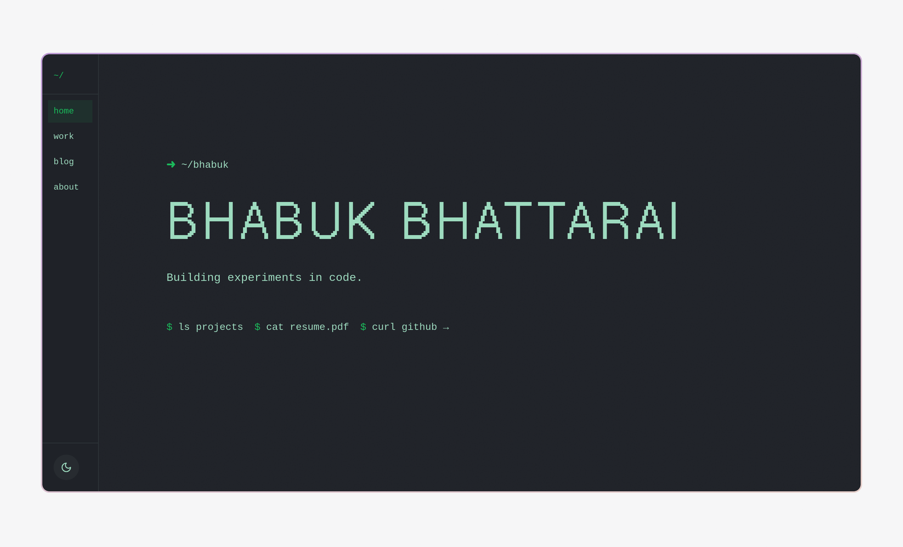

# Bhabuk Bhattarai — Portfolio

A personal portfolio site with a terminal/CLI-inspired aesthetic — built with Next.js, TypeScript, and Tailwind CSS. It features a glitching pixel-font hero, a typing animation, scroll-revealed sections, and a blog rendered from markdown with syntax highlighting.

**[Live site](https://bhabukb.com.np)**



## Features

- **Terminal aesthetic** — CLI-style prompt, typing effect, glitch animation, pixel noise overlay, and a custom cursor
- **Blog** — markdown posts with syntax highlighting, tags, and related-post suggestions
- **Theme toggle** — light/dark mode via CSS custom properties
- **SEO** — OpenGraph/Twitter cards, JSON-LD structured data, `sitemap.xml` and `robots.txt` (robots are noindexed on preview deployments)
- **Analytics** — Vercel Analytics
- **Responsive** — fixed sidebar navigation on desktop, slide-in mobile menu on smaller screens

## Tech Stack

- **Framework**: Next.js 14 (App Router)
- **Language**: TypeScript (strict mode)
- **Styling**: Tailwind CSS v4, class-variance-authority, tailwind-merge
- **Animation**: Framer Motion
- **UI primitives**: Radix UI, Lucide icons
- **Markdown**: react-markdown, remark-gfm, rehype-highlight
- **Forms**: react-hook-form
- **Fonts**: Geist Pixel Square via `next/font/google`

## Getting Started

### Prerequisites

- Node.js 18.17+ (Next.js 14 requirement)
- npm

### Installation

```bash
npm install
```

### Development

```bash
npm run dev
```

Open [http://localhost:3000](http://localhost:3000) in your browser.

### Production

```bash
npm run build
npm run start
```

### Lint

```bash
npm run lint
```

## Project Structure

```
├── app/                    # App Router pages and route handlers
│   ├── blog/[id]/         # Dynamic blog post pages
│   ├── json-ld.tsx        # JSON-LD structured data
│   ├── layout.tsx         # Root layout, metadata, fonts
│   ├── page.tsx           # Home page (single-page sections)
│   ├── robots.ts          # Robots config
│   └── sitemap.ts         # Sitemap generation
├── components/            # React components
│   ├── ui/                # Reusable UI primitives
│   └── *.tsx              # Feature sections (hero, work, blog, about, contact)
├── hooks/                 # Custom React hooks
├── lib/
│   ├── blog/              # Markdown loader (server-only) + BlogPost types
│   ├── blog-posts/        # Barrel re-export used across the app
│   └── utils.ts           # cn() helper
├── scripts/               # sync-assets.mjs (content/blog → public/blog)
├── content/blog/          # Markdown mirror of the Obsidian vault (generated)
└── public/                # Static assets (images, resume, audio)
```

## Writing and Publishing Blog Posts

Posts are written in **Obsidian** and deployed through git — there is no CMS and no code change per post.

Notes live in the `blog/` folder of the Obsidian vault (`ftbhabuk/obsidian-vault`).
A workflow in that repo mirrors `blog/` into `content/blog/` here whenever the vault is pushed,
which triggers a Vercel deploy.

1. Write or move a note into `blog/` in the vault.
2. Give it frontmatter:

```yaml
---
title: My Post Title             # optional if the note starts with "# My Post Title"
excerpt: A brief description     # optional, falls back to the first paragraph
date: 2026-10-21                 # required, YYYY-MM-DD
category: Technology             # optional, defaults to "blog"
tags: [tag1, tag2]               # optional
image: /images/hero.jpg          # optional hero image from public/images
draft: true                      # optional, keeps it out of the build
---
```

3. In Obsidian, run **Obsidian Git → Commit-and-sync** (bind it to a hotkey). That's the publish button.
4. The vault workflow commits the mirror to this repo and Vercel rebuilds.

Notes in `blog/_drafts/` are never synced. Pasted images land in `blog/attachments/` and are served
from `/blog/attachments/...`; `scripts/sync-assets.mjs` copies them into `public/blog/` before
dev/build. `content/blog/` is generated — never edit it here.

Adding a post should never require touching `lib/`, `app/` or `components/`.

## Deployment

Deploy to Vercel with the included `vercel-build` script. The site is Vercel-aware: search indexing is disabled automatically on preview deployments via the `VERCEL_ENV` environment variable.
